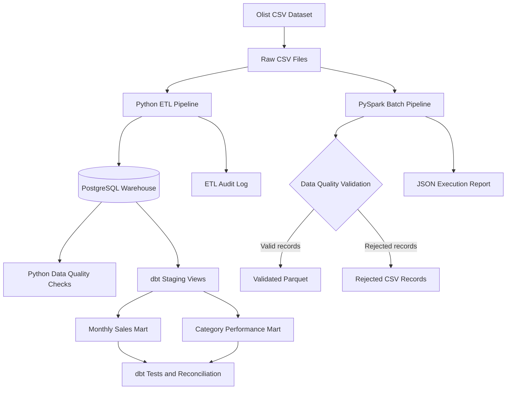

# E-Commerce Data Engineering Platform

An end-to-end Data Engineering portfolio project that processes historical e-commerce data using Python, PostgreSQL, SQL, dbt, and PySpark. The project demonstrates ETL pipelines, incremental loading, data-quality validation, warehouse transformations, analytical data marts, and batch processing with Parquet.

**Repository:** [ecommerce-data-engineering](https://github.com/TejaswiniH123/ecommerce-data-engineering)

---

## Overview

This project uses the [Brazilian E-Commerce Public Dataset by Olist](https://www.kaggle.com/datasets/olistbr/brazilian-ecommerce) to demonstrate how raw relational data can be transformed into reliable, analytics-ready datasets.

The project focuses on practical Data Engineering skills:

- Python-based ETL and PostgreSQL data loading
- Relational schema design, primary keys, and foreign keys
- Full-refresh and incremental loading patterns
- Upserts and pipeline execution auditing
- Data-quality validation and automated testing
- SQL analytics and business metric definitions
- dbt staging transformations and analytical data marts
- PySpark batch processing and record-level validation
- Parquet output generation and verification
- JSON execution reports and failure handling
- Git and GitHub version control

The project runs locally on Windows using a Python virtual environment and PostgreSQL. **Docker is not required.**

## Architecture

The project currently contains two separate processing workflows.

1. The Python ETL workflow loads data into PostgreSQL, where SQL and dbt produce analytical models.
2. The PySpark workflow processes order-item CSV data, validates records, and writes valid records to Parquet.

The Spark output is not yet connected to the PostgreSQL/dbt analytical workflow.



## Technology Stack

| Technology | Purpose |
|---|---|
| Python 3.11 | ETL, incremental loaders, and validation |
| PostgreSQL 18 | Relational warehouse and SQL analytics |
| SQL | Schema creation, transformations, aggregations, and business metrics |
| dbt Core | Staging transformations, analytical marts, and data tests |
| dbt-postgres | PostgreSQL adapter for dbt |
| PySpark 3.5.6 | Batch processing and data-quality validation |
| Java 11 | Java runtime for the selected PySpark version |
| Parquet | Columnar storage for validated Spark output |
| JSON | Pipeline execution reports |
| psycopg2-binary | Python–PostgreSQL connectivity |
| python-dotenv | Local environment configuration |
| pytest | Automated Python tests |
| Git and GitHub | Version control and project hosting |

## Data Source

The project uses the historical Olist Brazilian e-commerce dataset, covering approximately 2016–2018.

The PostgreSQL ETL workflow loads eight datasets:

- Customers
- Orders
- Products
- Sellers
- Order items
- Payments
- Reviews
- Product category translations

The Spark workflow currently processes the order-item dataset:

`olist_order_items_dataset.csv`

The source dataset is static historical data, not a live transaction feed. Raw CSV files are stored locally and excluded from version control.

The dataset is subject to its published license and attribution requirements. Review the [Olist dataset page](https://www.kaggle.com/datasets/olistbr/brazilian-ecommerce) before redistributing the data or derived materials. The dataset is licensed under CC BY-NC-SA 4.0; observe its non-commercial and share-alike conditions.

## Repository Structure

```text
ecommerce-data-engineering/
├── docs/
│   └── data_quality_findings.md
├── ecommerce_analytics/
│   ├── models/
│   │   ├── staging/
│   │   └── marts/
│   ├── tests/
│   └── dbt_project.yml
├── sql/
│   ├── 01_create_core_tables.sql
│   ├── 02_create_remaining_tables.sql
│   ├── 03_create_etl_run_log.sql
│   ├── 04_extend_etl_run_log.sql
│   └── 05–10 analytical SQL scripts
├── src/
│   ├── load_pipeline.py
│   ├── load_pipeline_tracked.py
│   ├── run_incremental_pipeline.py
│   ├── validate_data.py
│   └── supporting ETL and validation scripts
├── spark_jobs/
│   ├── 01_spark_smoke_test.py
│   ├── 02_process_order_items.py
│   ├── 03_write_order_items_parquet.py
│   ├── 04_validate_order_items.py
│   ├── 05_order_items_pipeline.py
│   └── order_items_validation.py
├── tests/
│   ├── test_data_quality.py
│   ├── test_spark_validation.py
│   └── test_validator_logic.py
├── .env.example
├── .gitignore
├── requirements.txt
└── README.md
```

Local data, generated Parquet files, execution reports, logs, virtual environments, credentials, and generated dbt artifacts are intentionally excluded from version control.

## Key Features

### 1. Python ETL and PostgreSQL Loading

The full-refresh pipeline loads eight related tables into PostgreSQL within a database transaction.

It checks expected source row counts and rolls back the transaction if the load fails.

**Important:** The full-refresh pipeline replaces existing table contents. Run it only against the intended project database when a full reload is required.

### 2. Incremental Loading

Separate scripts support incremental customer loading, order upserts, and order-item loading.

The orchestration script coordinates the incremental workflow. The implementation records insert, update, unchanged, and input counts where supported.

Incremental processing avoids treating every execution as a complete warehouse reload.

### 3. ETL Audit Logging

The `etl_run_log` table records execution information such as:

- Pipeline name and load type
- Execution status
- Start and completion timestamps
- Processed row counts
- Source information
- Error messages
- Inserted, updated, and unchanged row counts where supported

This makes it easier to investigate whether a pipeline run succeeded or failed.

### 4. Data-Quality Validation

The PostgreSQL validation scripts check:

- Expected table row counts
- Referential integrity
- Invalid review scores
- Negative prices, freight values, and payment values
- Orders without order items
- Repeated review identifiers

Known source-data anomalies are investigated and reported rather than automatically treated as errors or silently removed.

### 5. dbt Transformations

The dbt project contains five staging models:

- `stg_orders`
- `stg_customers`
- `stg_order_items`
- `stg_products`
- `stg_product_category_translation`

It also contains two analytical marts:

- `monthly_sales`
- `category_performance`

The staging models are views, while the analytical marts are tables.

The project uses dbt tests to validate the analytical models and supports reconciliation of business metrics.

### 6. Analytical SQL

Additional SQL scripts analyse:

- Monthly sales and average order value
- Category performance
- Repeat customers
- Delivery performance
- Monthly business summaries

Business metrics use explicit definitions to avoid mixing item sales, freight, and payment amounts.

### 7. PySpark Batch Processing

The project includes a PySpark pipeline that processes and validates Olist order-item data.

The pipeline performs the following steps:

1. Reads the source CSV using an explicit schema.
2. Applies reusable data-quality validation rules.
3. Separates valid records from rejected records.
4. Writes valid records to Parquet.
5. Writes rejected records to CSV when invalid records are found.
6. Verifies that the Parquet output row count matches the valid row count.
7. Writes a JSON execution report with the run status, timestamps, row counts, and error information.

The reusable validation logic is maintained in `spark_jobs/order_items_validation.py`.

The main pipeline is implemented in `spark_jobs/05_order_items_pipeline.py`.

The Spark workflow uses local execution with two worker threads and a limited driver-memory setting. It does not require Docker or a Spark cluster.

When a successful validation run finds zero rejected records, the pipeline removes an existing rejected-record directory so that stale rejected data is not left behind.

The pipeline reports failures through a JSON report and returns a non-zero exit code when processing fails.

## Verified Results

The following results were observed during local execution of the PostgreSQL and dbt workflows.

| Metric | Result |
|---|---:|
| Customer records | 99,441 |
| Order records | 99,441 |
| Product records | 32,951 |
| Seller records | 3,095 |
| Order-item records | 112,650 |
| Payment records | 103,886 |
| Review records | 99,224 |
| dbt models | 7 |
| dbt data tests | 23 passed |
| Monthly sales periods | 23 |
| Monthly mart item gross sales | BRL 13,221,498.11 |
| Category mart item gross sales | BRL 13,221,498.11 |

The monthly and category marts reconcile to the same total item gross sales. These figures describe the historical dataset and are not live business metrics.

### PySpark Pipeline Results

Verified local execution results for the order-item CSV:

| Metric | Result |
|---|---:|
| Input order-item rows | 112,650 |
| Valid rows | 112,650 |
| Rejected rows | 0 |
| Verified Parquet output rows | 112,650 |
| Pipeline status | SUCCESS |
| Automated tests in the full suite | 32 passed |

The successful Spark run found no records violating the implemented validation rules. This does not establish that the source data is free of every possible quality issue.

The full test suite includes tests for Python data-quality logic, Spark validation rules, and validator behavior.

## Local Setup — Windows PowerShell

### Prerequisites

Install the following:

- Git
- Python 3.11
- PostgreSQL 18
- Java 11 for the PySpark workflow

Make sure PostgreSQL is running before creating the database.

### 1. Clone the Repository

```powershell
git clone https://github.com/TejaswiniH123/ecommerce-data-engineering.git
cd ecommerce-data-engineering
```

### 2. Create a Virtual Environment

```powershell
python -m venv .venv
.\.venv\Scripts\Activate.ps1
python -m pip install --upgrade pip
pip install -r requirements.txt
```

### 3. Download the Dataset

Download the Olist dataset from Kaggle and extract its CSV files into the local `data/raw/` directory.

Create the directory if necessary:

```powershell
New-Item -ItemType Directory -Force .\data\raw
```

Ensure the required CSV files are present, including:

- `olist_orders_dataset.csv`
- `olist_order_items_dataset.csv`
- `olist_customers_dataset.csv`
- The other source files used by the PostgreSQL ETL workflow

Do not add raw data files to Git.

### 4. Configure Database Credentials

Create a local `.env` file in the project root, using `.env.example` as the template.

Example configuration:

```dotenv
PGHOST=localhost
PGPORT=5432
PGDATABASE=ecommerce_dw
PGUSER=postgres
PGPASSWORD=your_local_password
```

Replace the password placeholder locally. Never commit `.env` or share its contents.

### 5. Create the Database and Schema

Create the project database:

```powershell
psql -U postgres -c "CREATE DATABASE ecommerce_dw;"
```

If `psql` is not recognised, use the PostgreSQL installation's `psql.exe` or add its `bin` directory to your PATH.

Apply the schema scripts in order:

```powershell
psql -U postgres -d ecommerce_dw -f .\sql\01_create_core_tables.sql
psql -U postgres -d ecommerce_dw -f .\sql\02_create_remaining_tables.sql
psql -U postgres -d ecommerce_dw -f .\sql\03_create_etl_run_log.sql
psql -U postgres -d ecommerce_dw -f .\sql\04_extend_etl_run_log.sql
```

These commands assume that your local PostgreSQL user is `postgres`.

### 6. Load the Data

Review the full-refresh script before running it. It replaces the existing contents of the eight warehouse tables.

Run:

```powershell
python .\src\load_pipeline_tracked.py
```

The wrapper records the full-refresh run in the ETL audit table.

### 7. Validate the Warehouse and Run Tests

```powershell
python .\src\validate_data.py
python -m pytest -v
```

Investigate failures and warnings rather than assuming every source-data anomaly is a pipeline defect.

### 8. Configure and Run dbt

Create the dbt profile file at:

`%USERPROFILE%\.dbt\profiles.yml`

Use the following profile structure:

```yaml
ecommerce_analytics:
  target: dev
  outputs:
    dev:
      type: postgres
      host: "{{ env_var('PGHOST') }}"
      user: "{{ env_var('PGUSER') }}"
      password: "{{ env_var('PGPASSWORD') }}"
      port: "{{ env_var('PGPORT') | int }}"
      dbname: "{{ env_var('PGDATABASE') }}"
      schema: analytics
      threads: 2
```

The dbt CLI does not automatically load the project's `.env` file. Load the environment variables into the current PowerShell process before running dbt:

```powershell
Get-Content .\.env | ForEach-Object {
    if ($_ -match '^\s*([^#\s][^=]*)=(.*)$') {
        [Environment]::SetEnvironmentVariable(
            $matches[1].Trim(),
            $matches[2].Trim(),
            "Process"
        )
    }
}
```

This command sets the variables without printing their values.

Run the dbt commands from the project root:

```powershell
dbt debug --project-dir .\ecommerce_analytics
dbt parse --project-dir .\ecommerce_analytics
dbt run --project-dir .\ecommerce_analytics
dbt test --project-dir .\ecommerce_analytics
```

Generate the documentation site if required:

```powershell
dbt docs generate --project-dir .\ecommerce_analytics
dbt docs serve --project-dir .\ecommerce_analytics
```

### 9. Run the Incremental Pipeline

After the initial warehouse load and configuration are complete, run:

```powershell
python .\src\run_incremental_pipeline.py
```

Review the console output and ETL audit records to confirm the outcome.

### 10. Run the PySpark Pipeline

The Spark workflow uses the order-item CSV and writes its validated output locally.

Activate the virtual environment if it is not already active:

```powershell
.\.venv\Scripts\Activate.ps1
```

Run the pipeline from the project root:

```powershell
python .\spark_jobs\05_order_items_pipeline.py
```

The default paths are:

| Purpose | Path |
|---|---|
| Input CSV | `data/raw/olist_order_items_dataset.csv` |
| Validated Parquet output | `data/processed/parquet/validated_order_items` |
| Rejected records | `data/processed/rejected/order_items` |
| JSON execution report | `data/processed/reports/order_items_run_summary.json` |

The pipeline uses overwrite mode for its configured output paths. Review those paths before running it with custom inputs or outputs.

To test failure reporting without overwriting the normal output dataset, use a deliberately missing input file and a separate report path:

```powershell
python .\spark_jobs\05_order_items_pipeline.py `
  --input "data\raw\file_that_does_not_exist.csv" `
  --report "data\processed\reports\failure_test.json"
```

This test is expected to fail. The execution report should contain `"status": "FAILURE"`, an error message, and a completion timestamp. The process should return exit code `1`.

Inspect the report:

```powershell
Get-Content .\data\processed\reports\failure_test.json
```

### 11. Inspect the JSON Execution Report

After a normal successful Spark run:

```powershell
Get-Content .\data\processed\reports\order_items_run_summary.json
```

The report contains fields such as:

- `pipeline_name`
- `status`
- `started_at_utc`
- `finished_at_utc`
- `input_rows`
- `valid_rows`
- `rejected_rows`
- `parquet_output_rows`
- `source`
- `output`
- `rejected_output`
- `error_message`

The row counts help verify that the records were processed as expected. The status and error message help identify processing failures.

## Business Definitions

- **Item gross sales:** Sum of order-item prices for qualifying delivered orders.
- **Freight revenue:** Sum of order-item freight values, reported separately.
- **Average order value:** Item gross sales divided by delivered orders containing items; freight is excluded.
- **Category sales share:** Category item gross sales divided by total item gross sales.
- **Late delivery percentage:** Late delivered orders divided by eligible delivered orders with both actual and estimated delivery timestamps.

The dataset does not provide a dedicated refunds table, so net revenue after refunds is not calculated. Orders without order items are not assigned fabricated item revenue.

## Limitations and Future Improvements

- The dataset is historical, not a live transaction feed.
- Incremental processing covers selected entities rather than a complete change-data-capture implementation.
- The Spark workflow is currently separate from the PostgreSQL/dbt workflow.
- The project does not implement a production scheduler or cloud deployment.
- Spark currently processes the order-item dataset rather than all source datasets.
- More integration tests, monitoring, and additional warehouse models could strengthen the implementation.

## License and Attribution

The Olist dataset is provided under its published license. Review the [dataset's Kaggle page](https://www.kaggle.com/datasets/olistbr/brazilian-ecommerce) for applicable terms before reusing or redistributing source data or derived materials.

The project source code is maintained separately from the dataset's license.

---

**Built as a practical Data Engineering portfolio project to demonstrate Python, SQL, PostgreSQL, ETL, incremental loading, data-quality testing, PySpark batch processing, Parquet, and dbt analytics.**