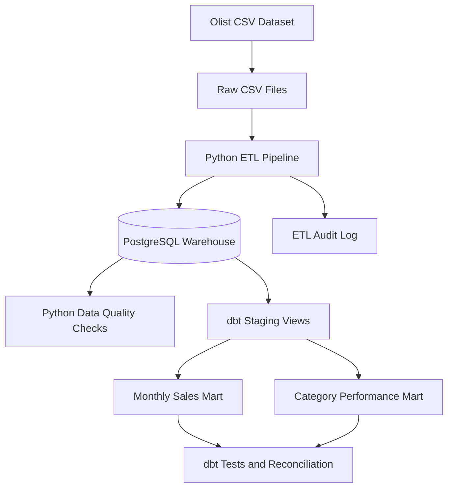

# E-Commerce Data Engineering Platform

An end-to-end data engineering project that ingests historical e-commerce data, loads it into PostgreSQL, validates data quality, supports incremental loading, and builds analytics-ready data marts with dbt.

**Repository:** [ecommerce-data-engineering](https://github.com/TejaswiniH123/ecommerce-data-engineering)

## Overview

This project uses the [Brazilian E-Commerce Public Dataset by Olist](https://www.kaggle.com/datasets/olistbr/brazilian-ecommerce) to demonstrate how raw relational data can be transformed into reliable analytics.

The implementation focuses on practical data engineering skills:

- Python-based ETL and PostgreSQL data loading
- Relational schema design, primary keys, and foreign keys
- Full-refresh and incremental loading patterns
- Upserts and pipeline execution auditing
- Data-quality validation and automated tests
- SQL analytics and dbt transformations
- Reconciliation of business metrics across analytical models

The project runs locally on Windows using PostgreSQL and a Python virtual environment. **Docker is not required.**

## Architecture



## Technology Stack

| Technology | Purpose |
|---|---|
| Python 3.11 | ETL, incremental loaders, and validation |
| PostgreSQL 18 | Relational warehouse and SQL analytics |
| SQL | Schema creation, aggregation, and business metrics |
| dbt Core | Staging transformations, analytical marts, and data tests |
| `dbt-postgres` | PostgreSQL adapter for dbt |
| `psycopg2-binary` | Python–PostgreSQL connectivity |
| `python-dotenv` | Local environment configuration |
| `pytest` | Automated Python tests |
| Git and GitHub | Version control and project hosting |

## Data Source

The project uses the historical Olist Brazilian e-commerce dataset, covering approximately 2016–2018.

The pipeline loads eight datasets:

- Customers
- Orders
- Products
- Sellers
- Order items
- Payments
- Reviews
- Product category translations

The source dataset is static historical data, not a live transaction feed. Raw CSV files are excluded from this repository and must be downloaded separately.

Review the dataset's license, attribution requirements, and non-commercial/share-alike conditions before redistributing the data or derived materials.

## Repository Structure

```text
ecommerce-data-engineering/
├── docs/
│   └── data_quality_findings.md
├── ecommerce_analytics/
│   ├── models/
│   │   ├── staging/
│   │   └── marts/
│   ├── tests/
│   └── dbt_project.yml
├── sql/
│   ├── 01_create_core_tables.sql
│   ├── 02_create_remaining_tables.sql
│   ├── 03_create_etl_run_log.sql
│   ├── 04_extend_etl_run_log.sql
│   └── 05–10 analytical SQL scripts
├── src/
│   ├── load_pipeline.py
│   ├── load_pipeline_tracked.py
│   ├── run_incremental_pipeline.py
│   ├── validate_data.py
│   └── supporting ETL and validation scripts
├── tests/
│   ├── test_data_quality.py
│   └── test_validator_logic.py
├── .env.example
├── .gitignore
├── requirements.txt
└── README.md
```

Local data, log files, virtual environments, credentials, and generated dbt artifacts are intentionally excluded from version control.

## Key Features

### 1. ETL and PostgreSQL loading

The full-refresh pipeline loads eight related tables in a database transaction. It checks the expected row count for each source table and rolls back the transaction if the load fails.

**Important:** The full-refresh pipeline truncates existing table contents before loading. Run it only against the intended project database when a full reload is required.

### 2. Incremental loading

Separate scripts support incremental customer loading, order upserts, and order-item loading. An orchestration script coordinates the incremental pipeline.

The implementation records insert, update, unchanged, and input counts where supported.

### 3. ETL audit logging

The `etl_run_log` table records pipeline name, load type, status, start and completion timestamps, processed row counts, and error information. Incremental metrics are also supported.

This helps investigate whether a pipeline run succeeded or failed.

### 4. Data-quality validation

The validation scripts check:

- Expected table row counts
- Referential integrity
- Invalid review scores
- Negative prices, freight values, and payment values
- Orders without order items
- Repeated review identifiers

Known source-data anomalies are investigated and reported rather than automatically treated as errors or silently removed.

### 5. dbt transformations

The dbt project contains five staging models:

- `stg_orders`
- `stg_customers`
- `stg_order_items`
- `stg_products`
- `stg_product_category_translation`

It also contains two analytical marts:

- `monthly_sales`
- `category_performance`

The staging models are views, and the analytical marts are tables.

### 6. Analytical SQL

Additional SQL scripts analyse:

- Monthly sales and average order value
- Category performance
- Repeat customers
- Delivery performance
- Monthly business summaries

Business metrics use explicit definitions to avoid mixing item sales, freight, and payment amounts.

## Verified Results

Results from the implemented local dataset and dbt run:

| Metric | Result |
|---|---:|
| Customer records | 99,441 |
| Order records | 99,441 |
| Product records | 32,951 |
| Seller records | 3,095 |
| Order-item records | 112,650 |
| Payment records | 103,886 |
| Review records | 99,224 |
| dbt models | 7 |
| dbt data tests | 23 passed |
| Monthly sales periods | 23 |
| Monthly mart item gross sales | BRL 13,221,498.11 |
| Category mart item gross sales | BRL 13,221,498.11 |

The monthly and category marts reconcile to the same total item gross sales. These figures describe the historical dataset and are not live business metrics.

## Local Setup — Windows PowerShell

### Prerequisites

Install the following:

- Git
- Python 3.11
- PostgreSQL 18

Make sure the PostgreSQL service is running before creating the database.

### 1. Clone the repository

```powershell
git clone https://github.com/TejaswiniH123/ecommerce-data-engineering.git
cd ecommerce-data-engineering
```

### 2. Create a virtual environment

```powershell
python -m venv .venv
.\.venv\Scripts\Activate.ps1
python -m pip install --upgrade pip
pip install -r requirements.txt
```

### 3. Download the dataset

Download the Olist dataset from Kaggle and extract its CSV files into a local `data/raw/` directory.

Create the directory if necessary:

```powershell
New-Item -ItemType Directory -Force .\data\raw
```

Ensure that the eight CSV files required by the pipeline are present, including `olist_orders_dataset.csv` and `olist_order_items_dataset.csv`.

Do not add the raw data to Git.

### 4. Configure database credentials

Create a local `.env` file in the project root. Use `.env.example` as the template and enter your own local PostgreSQL credentials.

```dotenv
PGHOST=localhost
PGPORT=5432
PGDATABASE=ecommerce_dw
PGUSER=postgres
PGPASSWORD=your_local_password
```

Replace the password placeholder locally. Never commit `.env` or share its contents.

### 5. Create the database and schema

Create the project database:

```powershell
psql -U postgres -c "CREATE DATABASE ecommerce_dw;"
```

If `psql` is not recognised, use the PostgreSQL installation's `psql.exe` or add its `bin` directory to your PATH.

Apply the schema scripts in order:

```powershell
psql -U postgres -d ecommerce_dw -f .\sql\01_create_core_tables.sql
psql -U postgres -d ecommerce_dw -f .\sql\02_create_remaining_tables.sql
psql -U postgres -d ecommerce_dw -f .\sql\03_create_etl_run_log.sql
psql -U postgres -d ecommerce_dw -f .\sql\04_extend_etl_run_log.sql
```

Enter your PostgreSQL password when prompted. These commands assume the local PostgreSQL user is `postgres`.

### 6. Load the data

Review the full-refresh script before running it. It replaces the existing contents of the eight warehouse tables.

Run:

```powershell
python .\src\load_pipeline_tracked.py
```

The wrapper records the full-refresh run in the ETL audit table.

### 7. Validate the warehouse

Run the data-quality checks:

```powershell
python .\src\validate_data.py
python -m pytest -v
```

Investigate any failures or warnings rather than assuming that every source anomaly is a pipeline defect.

### 8. Configure and run dbt

Create the dbt profile file at:

`%USERPROFILE%\.dbt\profiles.yml`

Use the following profile:

```yaml
ecommerce_analytics:
  target: dev
  outputs:
    dev:
      type: postgres
      host: "{{ env_var('PGHOST') }}"
      user: "{{ env_var('PGUSER') }}"
      password: "{{ env_var('PGPASSWORD') }}"
      port: "{{ env_var('PGPORT') | int }}"
      dbname: "{{ env_var('PGDATABASE') }}"
      schema: public
      threads: 2
```

The dbt CLI does not automatically load the project's `.env` file. Load the variables into the current PowerShell process before running dbt:

```powershell
Get-Content .\.env | ForEach-Object {
    if ($_ -match '^\s*([^#\s][^=]*)=(.*)$') {
        [Environment]::SetEnvironmentVariable(
            $matches[1].Trim(),
            $matches[2].Trim(),
            "Process"
        )
    }
}
```

This command sets environment variables without printing their values.

Run the dbt commands from the project root:

```powershell
dbt debug --project-dir .\ecommerce_analytics
dbt parse --project-dir .\ecommerce_analytics
dbt run --project-dir .\ecommerce_analytics
dbt test --project-dir .\ecommerce_analytics
```

Generate the documentation site if required:

```powershell
dbt docs generate --project-dir .\ecommerce_analytics
dbt docs serve --project-dir .\ecommerce_analytics
```

### 9. Run the incremental pipeline

After the initial warehouse load and configuration are complete, run:

```powershell
python .\src\run_incremental_pipeline.py
```

Review the console output and ETL audit records to confirm the outcome. Inspect the individual loader scripts before adapting the pipeline for different input batches.

## Business Definitions

- **Item gross sales:** Sum of order-item prices for qualifying delivered orders.
- **Freight revenue:** Sum of order-item freight values, reported separately.
- **Average order value:** Item gross sales divided by delivered orders containing items; freight is excluded.
- **Category sales share:** Category item gross sales divided by total item gross sales.
- **Late delivery percentage:** Late delivered orders divided by eligible delivered orders with both actual and estimated delivery timestamps.

The dataset does not provide a dedicated refunds table, so net revenue after refunds is not calculated. Orders without order items are not assigned fabricated item revenue.

## Limitations and Future Improvements

- The dataset is historical, not a live transaction feed.
- Incremental processing covers selected entities rather than a complete change-data-capture implementation.
- The current project does not implement a production scheduler or cloud deployment.
- More integration tests, monitoring, and additional warehouse models could strengthen the implementation.

## License and Attribution

The Olist dataset is provided under its published license. Review the [dataset's Kaggle page](https://www.kaggle.com/datasets/olistbr/brazilian-ecommerce) for the applicable terms before reusing or redistributing the source data or derived materials.

The project source code is maintained separately from the dataset's license.

---

*Built as a practical portfolio project to demonstrate Python, SQL, PostgreSQL, ETL, incremental loading, data-quality testing, and dbt analytics.*
